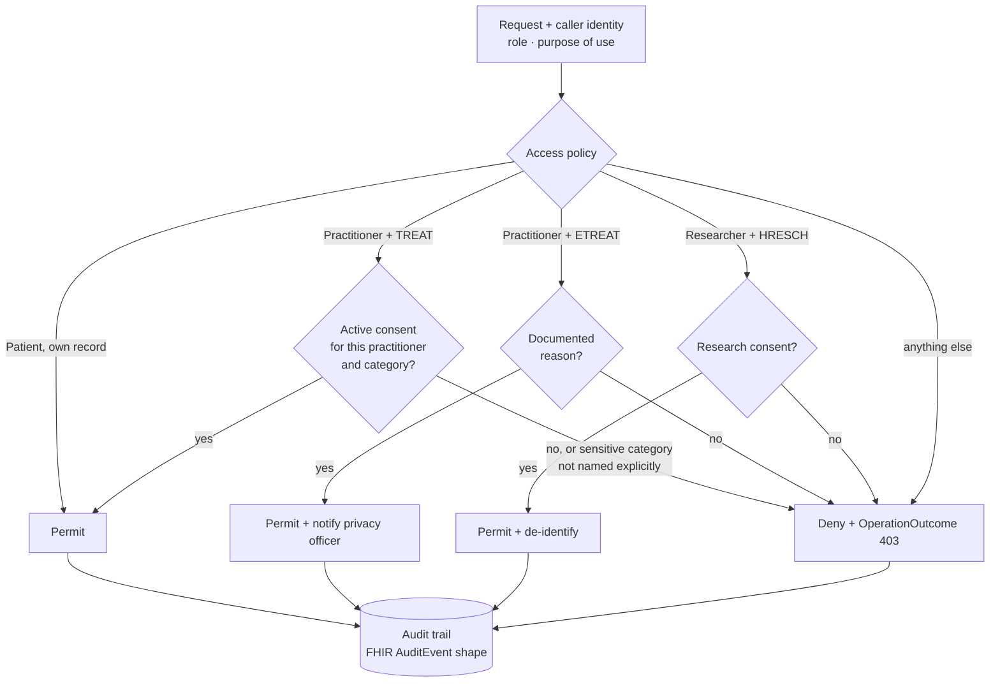

# fhir-consent-gateway-dotnet

**Patient data access is decided by consent, purpose and role. Every decision is explainable and audited.**

This is a .NET 10 reference **policy-enforcement gateway** in front of FHIR R4 resources. It shows how
to build healthcare APIs where *default deny* is real, sensitive data needs explicit consent,
break-glass is accountable, and research use is de-identified.

[](../../actions/workflows/ci.yml)


> All data in this repository is synthetic.

## How a request is decided



## Rules and the tests that prove them

| Rule | Test |
|---|---|
| Nothing is accessible without an explicit reason to permit | `Default_is_deny` |
| Consent is per practitioner, per category, time-bound and revocable | `Consent_is_per_practitioner`, `Revoked_and_expired_consents_are_ignored` |
| "All categories" never includes sensitive data such as mental health | `Consent_for_all_categories_does_not_unlock_sensitive_data` |
| Break-glass needs a documented reason and notifies the privacy officer | `Break_glass_requires_a_documented_reason`, `Break_glass_access_is_flagged…` |
| Research access is always de-identified: no names, exact dates or locations; ages over 89 grouped as 90+ | `Research_output_contains_no_direct_identifiers` |
| Pseudonyms are stable (HMAC), so records link without revealing identity | `Pseudonyms_are_stable…` |
| Denied attempts are audited as well as permitted ones | `Denials_are_audited_too` |

## Try it

```bash
dotnet test
dotnet run --project src/ConsentGateway --urls http://localhost:5079

DR='-H X-User:dr-1 -H X-Role:Practitioner -H X-Purpose:Treatment'
curl $DR "localhost:5079/fhir/Observation?patient=p-1001&category=vital-signs"     # 403: no consent yet

# The patient grants consent for all non-sensitive categories
curl -H X-User:p-1001 -H X-Role:Patient -H X-Purpose:Treatment -H "Content-Type: application/json" \
  -d '{"granteeId":"dr-1","purpose":"Treatment","categories":["*"],"days":30}' localhost:5079/consents

curl $DR "localhost:5079/fhir/Observation?patient=p-1001&category=vital-signs"     # 200
curl $DR "localhost:5079/fhir/Observation?patient=p-1001&category=mental-health"   # 403: sensitive category
curl -H X-User:priv-1 -H X-Role:PrivacyOfficer -H X-Purpose:Treatment localhost:5079/audit
```

The `X-*` headers stand in for a validated token. **Do not deploy header-based identity.**

## Production path

- Identity: SMART on FHIR / OIDC access tokens with scopes such as `patient/Observation.rs`, validated at the gateway.
- Data: a real FHIR server behind the gateway (Azure Health Data Services, HAPI FHIR, AWS HealthLake). Store consents as FHIR `Consent` resources.
- Audit: write FHIR `AuditEvent`s to immutable storage and stream them to a SIEM.
- Keys: keep the pseudonymisation key in Key Vault or KMS, with one key per research study.
- See [docs/threat-model.md](docs/threat-model.md) for the STRIDE review and the regulatory mapping.

---
Author: [Rubbaite T. Hassain](https://tanvir.info.bd) ([LinkedIn](https://www.linkedin.com/in/rubbaite)) · Software Architect, Founder of [Datazo InfoTech](https://www.datazoinfotech.com.bd) · MIT License

Architecture, requirements and review by Rubbaite T. Hassain; implementation AI-assisted.
